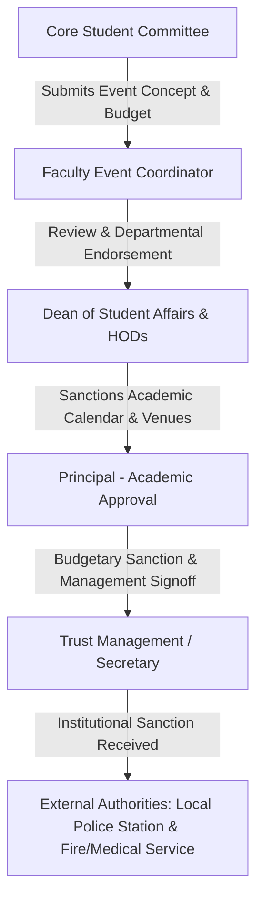

# Comprehensive Event Plan: KIT UDHAYAM 2027
**Flagship National-Level Inter-Collegiate Technical, Cultural & Sports Fest**  
**Institution:** Kalaignar Karunanidhi Institute of Technology (KIT), Coimbatore, Tamil Nadu  
**Target Edition:** KIT UDHAYAM 2027 (Next Edition Planning)  
**Author/Role:** Growth Associate Candidate & Student Organizing Committee Member  
**Planning Status:** Proposed Operational Plan (All assumptions, estimates, and approval workflows explicitly labeled)

---

## 1. Executive Summary & Event Identity

- **Event Name:** KIT UDHAYAM 2027 (*Udhayam* means "Sunrise" in Tamil, signifying innovation, emergence, and student potential)
- **Host Institution:** Kalaignar Karunanidhi Institute of Technology (KIT), Kannampalayam Post, Coimbatore, Tamil Nadu – 641402 (Autonomous institution, accredited by NAAC with 'A' Grade, affiliated with Anna University, approved by AICTE).
- **Core Purpose:** To provide a multi-disciplinary competitive platform bringing together engineering, technology, management, and arts students across South India to compete in technical hackathons, paper presentations, project expos, e-sports, fine arts, and cultural performances.
- **Intended Audience:** 
  - Internal: ~3,200 undergraduate and postgraduate students of KIT across all departments (CSE, AI & DS, IT, ECE, EEE, Mechanical, Mechatronics, Bio-Technology, Biomedical, Agriculture, MBA, MCA).
  - External: ~1,500+ student delegates from 45+ colleges across Tamil Nadu, Kerala, and Karnataka.
- **My Specific Role & Contribution:** As a student coordinator, I have designed this operational roadmap for the upcoming 2027 edition. Rather than claiming past unilateral organizing authority, this document establishes the end-to-end framework: timeline, itemized budget, approval gates, event-day run of show, risk mitigation, and recording ethics.

---

## 2. Confirmed Facts, Estimates & Evidence Sources

To preserve data integrity, all parameters are segregated by evidence type:

| Item | Status | Verification & Source |
|---|---|---|
| **College Name & Location** | **Confirmed Fact** | Kalaignar Karunanidhi Institute of Technology (KIT), Kannampalayam, Coimbatore. Official website: `kitcbe.com`. |
| **Institution Status** | **Confirmed Fact** | Autonomous, NAAC 'A' Grade, affiliated with Anna University. Established in 2008 by Vijayalakshmi Palanisamy Charitable Trust. |
| **Fest Name** | **Confirmed Fact** | **KIT UDHAYAM** is the established annual inter-collegiate fest (`kitudhayam.in`, verified on KnowAFest and Unstop portals). |
| **Typical Fest Period** | **Confirmed Fact** | Held annually in the even semester (February/March) prior to mid-semester and university examinations. |
| **Department Spectrum** | **Confirmed Fact** | Spans Circuits (CSE, AI-DS, IT, ECE, EEE), Core (Mech, Mechatronics, Agri), and Life Sciences (Biotech, Biomedical). |
| **Proposed 2027 Dates** | **Proposed Assumption** | Friday, 19 February 2027 & Saturday, 20 February 2027 (2-Day Fest). Chosen to avoid Anna University practical exams. |
| **Projected Footfall** | **Working Estimate** | 2,500 unique delegates across 2 days (1,500 internal + 1,000 external). Based on past festival capacity. |
| **Auditorium Capacity** | **Working Estimate** | Central Auditorium (~1,200 seating) + Open Air Amphitheatre (~2,500 capacity) + Department Seminar Halls (120 seating each). |
| **Approvals Status** | **Proposed Assumption** | Standard academic administrative workflow: Head of Department (HOD) -> Dean Student Affairs -> Principal -> Management. |

---

## 3. Measurable Objectives & Key Performance Indicators (KPIs)

1. **Participation KPIs:**
   - Total registrations: $\ge 2,500$ unique verified students.
   - External college reach: $\ge 40$ accredited colleges represented.
   - Inter-department balance: At least 300 entries in circuits (Coding/Hackathon), 200 in core engineering expos, and 150 in biotech/healthtech presentations.
2. **Operational KPIs:**
   - Zero security or indiscipline incidents on campus across 48 hours.
   - Average event registration queue wait time $< 4$ minutes via QR code mobile check-in.
   - Budget variance: Actual expenditure within $\pm 7\%$ of approved allocation.
3. **Growth & Engagement KPIs:**
   - Digital engagement: $\ge 50,000$ organic impressions across LinkedIn, Instagram, and college fest portals.
   - Post-event satisfaction: $\ge 85\%$ positive rating on standardized digital feedback forms.

---

## 4. Proposed Timing, Venue & Preparation Timeline

### Proposed Date Selection
- **Dates:** Friday, 19 February 2027 & Saturday, 20 February 2027.
- **Academic Context:** Aligns with the Anna University even-semester calendar window after internal assessment tests (IAT-1) and before final semester practical exams in late March. Avoids clash with regional tech symposiums in Coimbatore (e.g., CIT, PSG, Kumaraguru).

### Venue Allocation on KIT Campus
- **Central Auditorium:** Inauguration, Keynote, Valedictory, Flagship Tech Hackathon Finals.
- **Open Air Amphitheatre / Ground:** Evening Cultural Fest, Battle of the Bands, Choreo Night, Award Ceremony.
- **Computer Labs 1 to 4 (CSE & IT Blocks):** 24-Hour Code Sprint, AI/ML Model Hackathon, Web Debugging, E-Sports Arena.
- **Mechanical & Mechatronics Workshops:** CAD Modeling, Drone Obstacle Challenge, Line-Follower Robotics.
- **Biotech & Science Block Labs:** Poster Presentation, Project Expo, Waste-to-Energy Model Demonstrations.
- **Food Court / Cafeteria Plaza:** Centralized registration counter, sponsor kiosks, refreshment stalls.

### 16-Week Preparation Timeline

```
W-16 (Oct 2026): Core Committee Formation & Concept Note Submission
W-14 (Nov 2026): Administrative & Budgetary Approval from Principal & Management
W-12 (Dec 2026): Department Event Finalization, Rulebook Publication, Website Launch (kitudhayam.in)
W-08 (Jan 2027): Sponsorship Pitching, Industry Partner Onboarding, Poster Dispatch to 100+ Colleges
W-04 (Late Jan): Early Bird Registration Opening, Online Payment Gateway Testing, Vendor Quotations
W-02 (Feb 2027): Venue Booking Confirmation, Police/Ambulance NOC, Tech Infrastructure Dry Run
W-01 (12 Feb)  : Volunteer Orientation, Memento/Certificate Printing, Stage Setup Commences
Day 0 (18 Feb) : Full Rehearsal, AV Sound Check, QR Check-in Terminal Deployment
Days 1-2 (19-20 Feb): Fest Execution (Run of Show)
W+01 (Post-Fest): Expense Reconciliation, Winner Prize Disbursal, Feedback Synthesis, Video Wrap
```

---

## 5. Itemized Budget & Financial Model

*All figures are in Indian Rupees (INR), based on market estimates for tier-2 city college fests.*

| Cost Category | Item Description | Estimated Cost (INR) | Funding Source / Status |
|---|---|---:|---|
| **Prizes & Mementos** | Cash prizes across 24 technical & cultural events | ₹1,50,000 | Core Management Grant & Registration Fees |
| | Trophies, medals, and printed certificates (3,000 nos) | ₹45,000 | Registration Fees |
| **Stage & AV Production**| Professional sound, line-array speakers, LED backdrop wall | ₹1,20,000 | Title / Associate Sponsors |
| | Stage lighting, truss structure, generator backup | ₹60,000 | Associate Sponsor |
| **Hospitality & Catering** | Guest speakers & judges honorarium + travel accommodation | ₹40,000 | Management Grant |
| | Judges lunch, committee meals, volunteer refreshments (2 days) | ₹75,000 | Registration Fees |
| **Promotion & Branding** | Flex banners (20 nos), hoardings, posters dispatched to colleges | ₹35,000 | Sponsor In-kind / College Budget |
| | Social media ads, digital fest portal listings, website hosting | ₹15,000 | Digital Marketing Budget |
| **Safety & Logistics** | St. John Ambulance / medical first-aid on campus, barricading | ₹20,000 | Institutional Overhead |
| | Badges, wristbands, volunteer lanyards, stationary | ₹15,000 | Registration Fees |
| **Contingency Fund** | Unforeseen repairs, electrical backup, weather adjustments (7.5%) | ₹45,000 | Management Reserve |
| **TOTAL ESTIMATED BUDGET** | | **₹6,20,000** | |

### Projected Revenue Streams
- **College Management Seed Grant:** ₹2,50,000 (Approved baseline)
- **Delegate Registration Fees:** ₹2,40,000 (Projected: 800 external passes @ ₹300 per delegate for all-access technical pass)
- **Corporate Sponsorships:** ₹1,50,000 (Targeting local IT, manufacturing, and ed-tech sponsors: 1 Title @ ₹75k, 2 Co-Sponsors @ ₹35k, 2 Stall Sponsors @ ₹10k)
- **Total Projected Inflow:** **₹6,40,000** (Net contingency surplus: ₹20,000)

---

## 6. Permissions & Administrative Approval Workflow

No college event can proceed without rigorous institutional clearances. Below is the strict hierarchy of approvals required:



1. **Internal Institutional Approvals:**
   - *Academic Scheduling Approval:* Signed letter to Principal ensuring no academic lectures or mandatory exams conflict.
   - *Campus Facility Requisition:* Approval from Campus Maintenance Head for Central Auditorium, Labs, generators, and night security.
   - *Financial Sanction Request:* Joint sign-off by Faculty Coordinator and Accounts Officer for release of seed advances.
2. **External / Statutory Compliances:**
   - *Local Police Station Intimation:* Formal intimation letter submitted to Sulur / Kannampalayam Police Station for crowd intimation and external traffic management.
   - *Emergency Medical Service:* Formal tie-up with nearby hospital (e.g., KMCH or local clinic) for dedicated on-site paramedic van.

---

## 7. Organizing Committee Structure & Event-Day Responsibilities

- **Faculty Steering Committee:** Chief Patron (Principal), Convener (Dean Student Affairs), Staff Coordinators (1 per Department).
- **Core Student Committee (My Operating Sphere):**
  - **Overall Student Convener:** Oversees schedule adherence, inter-team escalation, and master stage cues.
  - **Technical Events Lead:** Oversees 14 department technical competitions, judge rubric standardization, lab readiness.
  - **Cultural & Stage Lead:** Audio-visual synchronization, backstage coordination, master of ceremonies (EMCEE) roster.
  - **Logistics & Hospitality Lead:** Guest transport, accommodation, judges hospitality, meal distribution.
  - **Finance & Registration Lead:** Cash desk, QR validation terminals, on-the-spot registrations, prize payout receipts.
  - **Media, PR & Documentation Lead:** Official photographers, reel creators, press release drafting, consent enforcement.

---

## 8. Promotion, Outreach & Registration Strategy

1. **Digital & Community Promotion:**
   - Launch responsive fest portal (`kitudhayam.in`) with automated QR code pass generation upon payment.
   - Listing on national college fest platforms: Unstop, KnowAFest, CollegeBatch.
   - Instagram Campaign: 30-day countdown with department event teasers, problem statements, and past fest reels.
2. **Inter-Collegiate Physical Outreach:**
   - Printed brochures and invitation letters physically couriered to 85 engineering colleges across Coimbatore, Tirupur, Erode, Salem, Palakkad, and Kochi.
   - Student ambassador network: Campus ambassadors appointed in 20 major target colleges with free registration incentives for group delegations ($>15$ entries).
3. **On-Campus Buzz:**
   - Flash mob in cafeteria plaza 10 days prior; teaser poster reveal by Principal during morning assembly.

---

## 9. Master Event-Day Run of Show (Agenda)

### Day 1: Friday, 19 February 2027 (Technical Focus & Hackathon)

| Time | Event / Activity | Location | Lead Responsibility |
|---|---|---|---|
| **08:00 – 09:30** | Registration Desk Opens; Badge & Welcome Kit Distribution | Cafeteria Concourse | Registration Team (8 volunteers) |
| **09:30 – 10:45** | Formal Inauguration: Lighting of Kuthuvilakku, Presidential Address by Principal, Keynote by Industry Chief Guest | Central Auditorium | Stage & EMCEE Team |
| **10:45 – 11:15** | High Tea & Networking for Judges and Faculty Delegates | VIP Lounge | Hospitality Team |
| **11:15 – 13:30** | **Session 1: Flagship Competitions Commences**<br>• Smart India AI Hackathon (Kickoff)<br>• National Technical Paper Presentation<br>• CAD Modeling & Rapid Prototyping<br>• Biotech Bio-Innovation Poster Expo | <br>CSE Labs 1-2<br>Mech Seminar Hall<br>CAD Lab<br>Biotech Block | Department Faculty & Student Event Coordinators |
| **13:30 – 14:30** | Lunch Break (Distributed meal boxes for delegates) | Food Court | Hospitality Team |
| **14:30 – 17:00** | **Session 2: Afternoon Challenges**<br>• Line-Follower Robotics Combat<br>• Web Debugging & Blind Coding<br>• Technical Quiz Finals | <br>Main Quadrangle<br>IT Lab 3<br>Auditorium | Event Leads |
| **17:00 – 18:30** | Hackathon Progress Review (Round 1 Evaluation) | CSE Lab 1 | Industry Mentors |
| **18:30 – 20:30** | Inaugural Evening: Acoustic Band Performance & Standup Comedy | Amphitheatre | Cultural Team |

### Day 2: Saturday, 20 February 2027 (Cultural, E-Sports & Valedictory)

| Time | Event / Activity | Location | Lead Responsibility |
|---|---|---|---|
| **08:30 – 09:30** | Day 2 Helpdesk & Late Delegate Check-in | Main Entrance | Registration Desk |
| **09:30 – 13:00** | **Parallel Tracks:**<br>• 24-Hr Hackathon Final Pitching & Demo<br>• E-Sports Tournament (Valorant / BGMI Finals)<br>• Short Film Screening & Photography Expo<br>• Solo/Group Singing Competitions | <br>Auditorium<br>Lab 4<br>Mini Audio Room<br>Music Room | Technical & Media Leads |
| **13:00 – 14:00** | Lunch Break | Food Court | Hospitality Team |
| **14:00 – 17:30** | **Choreo Night (Inter-Collegiate Dance Competition):**<br>• Western Group Dance<br>• Folk / Classical Dance Fusion | Central Auditorium | Cultural Lead & Security |
| **17:30 – 19:00** | **Valedictory Ceremony:**<br>• Announcement of Overall Championship Trophy<br>• Cash Prize & Certificate Distribution by Management<br>• Vote of Thanks | Central Auditorium | Convener & Stage Team |
| **19:00 – 21:00** | DJ Night & Student Celebration (Campus Gates Close at 21:30) | Main Ground | Security & Physical Directors |

---

## 10. Attendance Tracking & Queue Management

- **Pre-Registration:** Attendees receive a digital ticket with unique QR code via email/SMS upon registration.
- **On-Arrival Check-in:** 4 parallel entry lanes equipped with mobile QR barcode scanners operated by volunteers. Scan automatically validates student ID, prints physical lanyard badge, and marks attendance in real-time Google Sheet/database.
- **Capacity Monitoring:** Door counter volunteers at Central Auditorium ensure hall occupancy never exceeds the 1,200 seat fire-safety threshold.

---

## 11. Risk Management & Contingency Protocols

| Risk Scenario | Likelihood | Impact | Preventative Action & Contingency Plan |
|---|---|---|---|
| **Power Failure during Stage Events** | Medium | High | Dedicated 125 kVA diesel generator on standby with automatic phase transfer switch. Tested on Day 0. |
| **Rain / Weather Interruption (Open Amphitheatre)** | Low-Medium | High | Rain contingency: All outdoor sound/lighting covered; evening cultural events shifted into Central Auditorium. |
| **Audio-Visual / Projector Glitch** | High | Medium | Backup HDMI cables, secondary laptops, and duplicate presentation drives kept at stage control podium. |
| **Overcrowding at Cultural / DJ Night** | Medium | High | Strict wristband-only access. Physical Education directors and external security deployed at all perimeter gates. |
| **Medical Emergency / Dehydration** | Medium | Medium | First-aid station near registration; dedicated on-site ambulance with 2 certified emergency nurses. |
| **Payment Gateway Downtime** | Medium | Low | Offline cash receipt books pre-stamped and serial-numbered for on-the-spot registrations. |

---

## 12. Photography, Video Production & Privacy Consent Policy

1. **Shot List & Documentation Strategy:**
   - *Inauguration & Dignitaries:* Wide auditorium shots, lighting of lamp, keynote speaker podium.
   - *Technical Sessions:* Close-ups of student coding screens, robotics arena motion shots, judges reviewing paper posters.
   - *Cultural Competitions:* Dynamic telephoto shots of dance performances, stage lighting captures, crowd reactions.
   - *Deliverable Assets:* (1) Same-day 60-second Instagram Reel; (2) Official 3-minute aftermovie for YouTube/college archive; (3) High-res photo album for college press release.
2. **Consent & Privacy Protocols:**
   - *Ticketing Disclaimer:* Registration form includes explicit clause: *"By registering, participants consent to photography and recording for institutional publicity purposes."*
   - *Opt-Out Mechanism:* Delegates desiring non-recording wear a distinct red lanyard badge; camera operators are briefed not to feature them in individual close-ups.
   - *Sensitive Data Protection:* No personal contact lists, phone numbers, or academic roll numbers will be published in post-event media.

---

## 13. Post-Event Feedback, Financial Reconciliation & Continuous Improvement

1. **Digital Feedback Collection:**
   - Automated Google Form / survey link triggered to all checked-in emails at 18:00 on Day 2.
   - Rating areas: Registration efficiency, technical judging fairness, hospitality, AV quality. Completion required to download automated digital participation certificates.
2. **Financial Auditing & Reconciliation (Within 5 Days):**
   - Collection of all original GST tax invoices for stage, sound, catering, and printing.
   - Reconciliation of cash box collections against bank statement deposits.
   - Submission of final utilization certificate signed by Faculty Coordinator to College Accounts Office.
3. **Knowledge Transfer Dossier:**
   - Archiving all event rulebooks, judge rubrics, vendor contacts, and feedback data in the college shared drive for the 2028 organizing committee.
